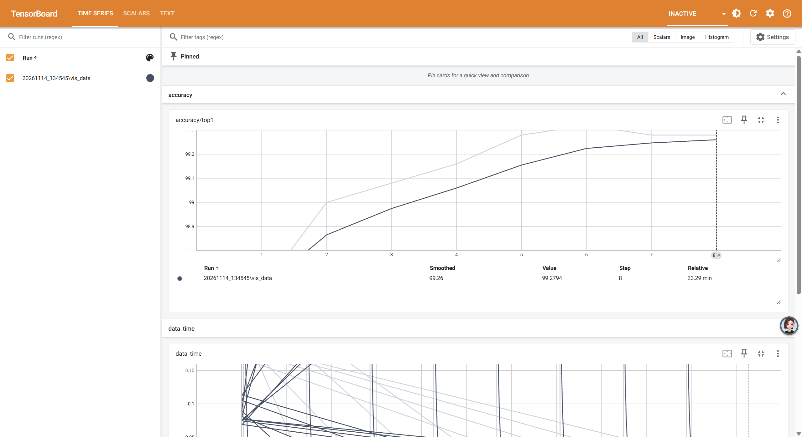
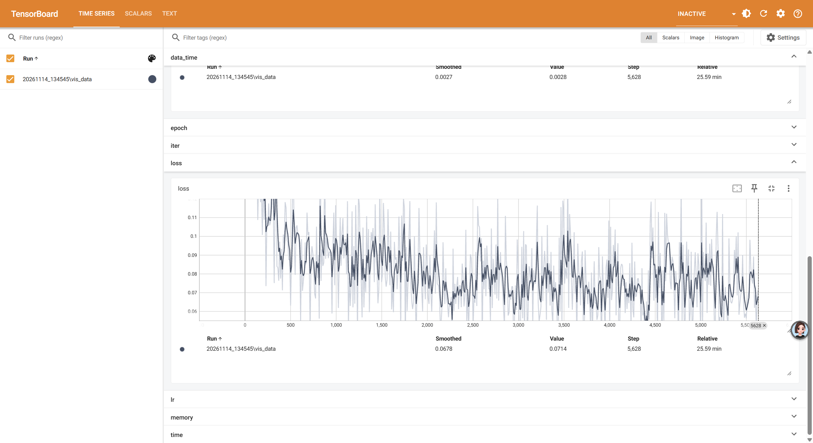
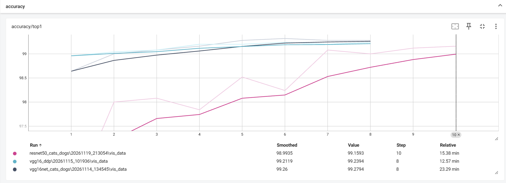
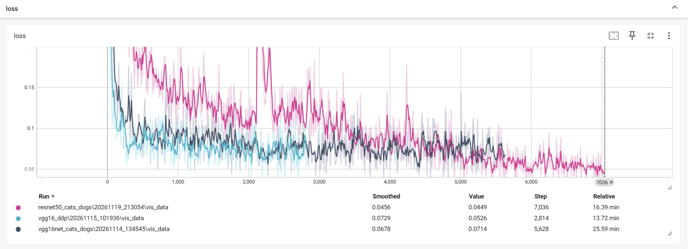

# 图像分类复现项目：VGGNet 与 ResNet-50 / SE-ResNet-50

本仓库包含两个**独立但同题**的图像分类复现项目，共用同一份猫狗数据和同一套
PyTorch + MMPretrain 环境：

- **[VGGNet](VGGNet/README.md)**：手写 VGG16（含 8 个变体），加载官方 ImageNet 权重，猫狗迁移学习。
- **[ResNet](ResNet/README.md)**：手写 ResNet-50，并集成 SENet 得到 SE-ResNet-50，做迁移学习和 SE 消融。

两个项目都完成了：**结构逐键对齐 → 官方权重加载 → 猫狗迁移（>95%）→ TensorBoard → 实拍推理 → DDP 多卡**。
所有指标来自 `work_dirs/` 下的真实日志和 `scalars.json`，不是论文数字。

## 总览

| 项目 | 结构 | 参数量（全模型） | 单卡 best | DDP best | DDP 硬件 |
| :--- | :--- | :-: | :-: | :-: | :--- |
| VGGNet | VGG16（13 conv + 3 FC） | **138.36M** | **99.32%** | **99.24%** | 2×RTX 3090 24GB |
| ResNet | ResNet-50 | **25.56M** | **99.16%** | **99.16%** | 2×RTX 4090 24GB |
| ResNet + SENet | SE-ResNet-50 | **28.09M** | **99.32%** | **99.00%** | 2×RTX 4090 24GB |

> VGG 是 8 epoch，ResNet 是 10 epoch；单卡是 RTX 5060 Laptop 8GB，双卡分别是 3090 / 4090。
> 因此**不要横向比较两个项目的训练耗时**，只能各自和本项目的单卡结果比较。

## 完成度

| 任务要求 | VGGNet | ResNet / SE-ResNet |
| :--- | :--- | :--- |
| 1. 手写结构，与官方逐键对齐 | ✅ 8 变体，`diff = 0.0` | ✅ ResNet-50 / SE-ResNet-50，`diff = 0.0` |
| 2. 加载官方 ImageNet-1k 权重 | ✅ 1000 类逐层灌入 | ✅ ResNet-50 / SE-ResNet-50 均 `diff = 0.0` |
| 3. 猫狗迁移，val top-1 > 95% | ✅ **99.32%** | ✅ ResNet **99.16%** / SE **99.32%** |
| 4. TensorBoard + 实拍推理 | ✅ loss/acc/lr + 实拍图 | ✅ loss/acc/lr + 5 张实拍 |
| 5. SENet 集成 + 消融 | — | ✅ SE 比 ResNet +0.16 点，参数 +2.53M |
| 6. DDP 多卡 | ✅ 2×3090，99.24% | ✅ 2×4090，99.16% / 99.00% |

## 环境

| 组件 | 版本 / 配置 |
| :--- | :--- |
| Python | 3.12.10 |
| PyTorch | 2.11.0+cu128 |
| mmpretrain | 1.2.0 |
| mmengine | 0.10.7 |
| mmcv | 2.2.0（**lite**，纯 Python，不编译 CUDA 算子） |
| tensorboard | 2.21.0 |
| 本机 | RTX 5060 Laptop 8GB / Ultra 9 275HX / 32GB RAM（Windows） |
| VGG 云端 | 恒源云 2×RTX 3090 24GB（Linux + NCCL） |
| ResNet 云端 | 恒源云 2×RTX 4090 24GB（Linux + NCCL） |
| 数据 | 微软猫狗 24,997 张可用，9:1 切成 **22,499 训练 / 2,498 验证** |

```powershell
cd D:\具身智能\Pratice_project
.\.venv\Scripts\python.exe -c "import torch, mmpretrain, mmengine, mmcv, tensorboard; print(torch.__version__, mmpretrain.__version__, mmengine.__version__, mmcv.__version__, tensorboard.__version__)"
```

> `.venv` 已就绪，不需要重新安装。项目 `.env` 里已有 `PYTHONUTF8=1`。
> 启动时那条 `Fail to import MultiScaleDeformableAttention ... mmcv-lite` 是**无害警告**。

## 目录结构

```text
Pratice_project/
├── VGGNet/
│   ├── config/                 # vgg16net_cats_dogs / mini / ImageNet 留档
│   ├── vggnet/backbones/vgg.py # ★ 手写 VGG（注册名 VGGNet）
│   ├── tools/                  # 数据、check、train、infer、summarize
│   ├── docs/                   # TODOLIST / 01 代码 / 02 训练
│   └── README.md
├── ResNet/
│   ├── config/                 # resnet50 / seresnet50 猫狗训练
│   ├── resnet/backbones/       # ★ 手写 ResNet + SENet
│   ├── tools/                  # check、train、infer、visualize_se
│   ├── docs/                   # TODOLIST / 01 代码 / 02 训练
│   ├── shotcut/                # TensorBoard 截图
│   └── README.md
├── data/
│   ├── raw/PetImages/          # 原始数据（可删）
│   └── cats_dogs/              # train/val × cat/dog
├── validation_photos/          # 实拍推理图片
├── work_dirs/                  # 两个项目的训练输出 / ckpt / TB events
└── README.md                   # 本文件
```

## 快速开始

**所有命令都在 `Pratice_project/` 下执行**，配置里的 `data_root = "data/cats_dogs"` 是相对当前工作目录的。

### 1. VGGNet

```powershell
cd D:\具身智能\Pratice_project

# 环境 / 结构 / 官方权重
.\.venv\Scripts\python.exe VGGNet\tools\check_env.py
.\.venv\Scripts\python.exe VGGNet\tools\check_parity.py
.\.venv\Scripts\python.exe VGGNet\tools\check_all_variants.py
.\.venv\Scripts\python.exe VGGNet\tools\check_pretrain.py

# 猫狗迁移（8 epoch，加载官方 VGG16 权重）
.\.venv\Scripts\python.exe VGGNet\tools\train.py VGGNet\config\vgg16net_cats_dogs.py

# 推理
.\.venv\Scripts\python.exe VGGNet\tools\infer_execute.py
```

### 2. ResNet-50 / SE-ResNet-50

```powershell
cd D:\具身智能\Pratice_project

# 环境 / 结构 / 官方权重
.\.venv\Scripts\python.exe ResNet\tools\check_env.py
.\.venv\Scripts\python.exe ResNet\tools\check_parity.py
.\.venv\Scripts\python.exe ResNet\tools\check_se_parity.py
.\.venv\Scripts\python.exe ResNet\tools\check_pretrain.py

# 单卡训练
.\.venv\Scripts\python.exe ResNet\tools\train.py ResNet\config\resnet50_cats_dogs.py
.\.venv\Scripts\python.exe ResNet\tools\train.py ResNet\config\seresnet50_cats_dogs.py

# 推理
.\.venv\Scripts\python.exe ResNet\tools\infer_execute.py
.\.venv\Scripts\python.exe ResNet\tools\infer_execute.py ^
  --config ResNet\config\seresnet50_cats_dogs.py ^
  --work-dir work_dirs\seresnet50_cats_dogs
```

### 3. TensorBoard

```powershell
# 两个项目的 run 都在 work_dirs 下，可以放在同一个页面比较
.\.venv\Scripts\tensorboard.exe --logdir work_dirs --port 6006

# 浏览器打开 http://localhost:6006
```

### 4. DDP（Linux 云端）

```bash
# VGG16，2×3090
torchrun --nproc_per_node=2 VGGNet/tools/train.py \
    VGGNet/config/vgg16net_cats_dogs.py --launcher pytorch \
    --work-dir work_dirs/vgg16_ddp

# ResNet-50，2×4090
torchrun --nproc_per_node=2 --master_port=29501 ResNet/tools/train.py \
    ResNet/config/resnet50_cats_dogs.py --launcher pytorch \
    --work-dir /hy-tmp/work_dirs/resnet50_ddp

# SE-ResNet-50，2×4090
torchrun --nproc_per_node=2 --master_port=29502 ResNet/tools/train.py \
    ResNet/config/seresnet50_cats_dogs.py --launcher pytorch \
    --work-dir /hy-tmp/work_dirs/seresnet50_ddp
```

> Windows 本机没有 NCCL，`gloo` + CUDA 会崩溃、`torchrun` 会报 libuv；多卡一律在 Linux 云端跑。

## 关键结果

### VGGNet

**结构对齐（8 变体）**

```text
depth=11 type=plain params= 132.86M diff=0.0
depth=13 type=plain params= 133.05M diff=0.0
depth=16 type=plain params= 138.36M diff=0.0
depth=19 type=plain params= 143.67M diff=0.0
depth=11 type=bn    params= 132.87M diff=0.0
depth=13 type=bn    params= 133.05M diff=0.0
depth=16 type=bn    params= 138.37M diff=0.0
depth=19 type=bn    params= 143.68M diff=0.0
```

**猫狗迁移（8 epoch，RTX 5060 8GB）**

| epoch | 1 | 2 | 3 | 4 | 5 | 6 | 7 | 8 |
| :--- | :-: | :-: | :-: | :-: | :-: | :-: | :-: | :-: |
| val top-1 | 98.64 | 99.00 | 99.08 | 99.16 | 99.28 | **99.32** | 99.28 | 99.28 |

- best **99.32%**（epoch 6），8 epoch 约 **25.6 分钟**，每卡 bs32 + AMP。
- DDP 2×3090：best **99.24%**，**14 分 23 秒**；VGG README 里的 **1.78×** 是相对本机 5060 的端到端对比，
  单卡 5060 与双卡 3090 硬件不同，不是纯 DDP 加速比。

### ResNet-50 / SE-ResNet-50

**结构对齐**

```text
ResNet-50     keys=318  backbone=23.51M  full=25.56M  diff=0.0
SE-ResNet-50  keys=382  backbone=26.04M  full=28.09M  diff=0.0
```

**单卡猫狗（10 epoch，RTX 5060 8GB）**

| 模型 | best top-1 | 最佳 epoch | 耗时 | 峰值显存 |
| :--- | :-: | :-: | :-: | :-: |
| ResNet-50 | **99.16%** | 10 | 17:08 | ~1.6 GB |
| SE-ResNet-50 | **99.32%** | 9 | 20:52 | ~2.0 GB |

**SE 消融**：SE 比 ResNet-50 高 **+0.16 个点**，参数多 **+2.53M（+10.8%）**，训练时间多约 **22%**。
只有一次 run，猫狗又是简单二分类，这个差距只能算“小幅提升/在噪声边缘”。

**2×4090 DDP**

| 模型 | 单卡 best | DDP best | 单卡耗时 | DDP 耗时 |
| :--- | :-: | :-: | :-: | :-: |
| ResNet-50 | 99.16% | **99.16%** | 17:08 | **6:50** |
| SE-ResNet-50 | 99.32% | **99.00%** | 20:52 | **7:55** |

- DDP 与单卡 best 差：ResNet **0.00 点**、SE **0.32 点**，均 < 1 点。
- 端到端 2.50× / 2.64×，但单卡是 5060、双卡是 4090，**硬件不同**，不是纯 DDP 加速比。

### 实拍推理

- VGG16：`validation_photos/` 5 张狗图全部判对；另有 1 张非猫非狗被强行判成 dog（2 分类没有拒识）。
- ResNet-50：5/5 正确。
- SE-ResNet-50：4/5 正确，`dog4.jpg` 判成 cat（0.5868），属于二分类边界上的失败样本。

### TensorBoard

VGG16（accuracy / loss）：





ResNet-50（accuracy / loss）：





## 两个项目的关键差异

| 项 | VGG16 | ResNet-50 / SE-ResNet-50 |
| :--- | :--- | :--- |
| 分类层位置 | `backbone.classifier`（3 层 FC） | `head.fc`（1 层 Linear） |
| `num_classes` 写在哪 | `backbone.num_classes` | `head.num_classes` |
| 官方权重分类键 | `backbone.classifier.6.*` | `head.fc.*` |
| 归一化 | 可选（VGG-BN） | 每个卷积后都有 BN |
| 特征图 | 7×7×512 | 7×7×2048 |
| 参数量 | 138.36M | 25.56M / 28.09M |
| 额外结构 | 无 | 残差 shortcut + SE 通道注意力 |
| 官方注册名 | `VGG` | `ResNet` / `SEResNet` |
| 自己注册名 | `VGGNet` | `MyResNet` / `MySEResNet` |

**为什么 VGG 参数多 5 倍却没更准？** VGG 的 3 层全连接（25088→4096→4096→1000）占了约 123M 参数，
而 ResNet 用全局平均池化 + 一个 `2048→2` 的线性层；在 25k 猫狗这种小数据上，两者都能到 99% 左右，
参数量差异更多是“结构不同”，不是“谁更强”。

## 关键踩坑（两个项目通用）

| 现象 | 原因 | 解决 |
| :--- | :--- | :--- |
| `UnboundLocalError: cannot access local variable 'config'` | `get_model(dict(...))` 传了普通 dict | 传 `Config(dict(model=...))` 或模型名字符串 |
| `size mismatch for ...classifier.6` / `head.fc` | 1000 类 → 2 类，正常 | **预期行为**，前面层照常复用 |
| `UnpicklingError: Weights only load failed` | torch ≥2.6 默认 `weights_only=True`，mmengine ckpt 里有 `HistoryBuffer` | 加 `tools/compat.py` 补丁 |
| Windows 上 `torchrun` / gloo 崩溃 | 无 NCCL、gloo 不支持 CUDA | 多卡上 Linux 云端 |
| `Fail to import MultiScaleDeformableAttention` | 用了 `mmcv-lite` | **无害警告**，忽略 |
| `FileNotFoundError: data/cats_dogs` | 不在 `Pratice_project/` 下启动 | `cd Pratice_project` 再跑 |
| `No module named 'vggnet'` / `'resnet'` | 没做 editable 安装 | `cd VGGNet` / `cd ResNet` 后 `pip install -e . --no-build-isolation` |
| SE 配置报 `KeyError: 'MySEResNet'` | 入口只 import 了 `resnet.backbones.resnet` | 用 `import resnet` 做包级导入 |
| `ImportError: cannot import name 'make_divisible' from 'mmcv.utils'` | `mmcv-lite` 没导出该符号 | 用 `from mmpretrain.models.utils import make_divisible` |

## 文档与结果

| 内容 | 位置 |
| :--- | :--- |
| VGGNet 总览 | [VGGNet/README.md](VGGNet/README.md) |
| VGGNet 代码 / 训练 TODO | [VGGNet/docs/TODOLIST.md](VGGNet/docs/TODOLIST.md) |
| VGGNet 代码部分 | [VGGNet/docs/01_代码部分.md](VGGNet/docs/01_代码部分.md) |
| VGGNet 训练部分 | [VGGNet/docs/02_训练部分.md](VGGNet/docs/02_训练部分.md) |
| ResNet 总览 | [ResNet/README.md](ResNet/README.md) |
| ResNet 代码 / 训练 TODO | [ResNet/docs/TODOLIST.md](ResNet/docs/TODOLIST.md) |
| ResNet 代码部分 | [ResNet/docs/01_代码部分.md](ResNet/docs/01_代码部分.md) |
| ResNet 训练部分 | [ResNet/docs/02_训练部分.md](ResNet/docs/02_训练部分.md) |
| VGG 单卡结果 | `work_dirs/vgg16net_cats_dogs/` |
| VGG DDP 结果 | `work_dirs/vgg16_ddp/` |
| ResNet 单卡结果 | `work_dirs/resnet50_cats_dogs/` |
| ResNet DDP 结果 | `work_dirs/resnet50_ddp/` |
| SE-ResNet 单卡结果 | `work_dirs/seresnet50_cats_dogs/` |
| SE-ResNet DDP 结果 | `work_dirs/seresnet50_ddp/` |

## 数据集与参考

- 数据：[Microsoft Cats and Dogs](https://download.microsoft.com/download/3/E/1/3E1C3F21-ECDB-4869-8368-6DEBA77B919F/kagglecatsanddogs_5340.zip)
  （Kaggle `dogs-vs-cats` 已关闭）
- VGG 论文：[Very Deep Convolutional Networks for Large-Scale Image Recognition](https://arxiv.org/abs/1409.1556)
- ResNet 论文：[Deep Residual Learning for Image Recognition](https://arxiv.org/abs/1512.03385)
- SENet 论文：[Squeeze-and-Excitation Networks](https://arxiv.org/abs/1709.01507)
- mmpretrain 模型库：[configs/vgg](https://github.com/open-mmlab/mmpretrain/tree/main/configs/vgg)、
  [configs/resnet](https://github.com/open-mmlab/mmpretrain/tree/main/configs/resnet)、
  [configs/seresnet](https://github.com/open-mmlab/mmpretrain/tree/main/configs/seresnet)
- 官方权重：
  - [VGG16](https://download.openmmlab.com/mmclassification/v0/vgg/vgg16_batch256_imagenet_20210208-db26f1a5.pth)
  - [ResNet-50](https://download.openmmlab.com/mmclassification/v0/resnet/resnet50_8xb32_in1k_20210831-ea4938fc.pth)
  - [SE-ResNet-50](https://download.openmmlab.com/mmclassification/v0/se-resnet/se-resnet50_batch256_imagenet_20200804-ae206104.pth)

## 已知限制

1. **没有做 ImageNet-1k 全量训练**：只验证结构对齐和官方权重加载，不对比论文的 71.6 / 76.55 / 77.74。
2. **VGG 只支持 224×224**：classifier 输入维度硬编码 `512*7*7`，换分辨率会报形状错误。
3. **ResNet 只复现 50 / SE-50**：18/34/101/152 不在本次验收范围。
4. **DDP 只在 Linux 云端验证**：Windows 本机无 NCCL；两个项目的 DDP 硬件不同（3090 vs 4090），耗时不可横向比较。
5. **实拍样本很少**：5 张狗图只能做冒烟，不能替代 2,498 张验证集指标；2 分类也没有“都不是”的拒识能力。
