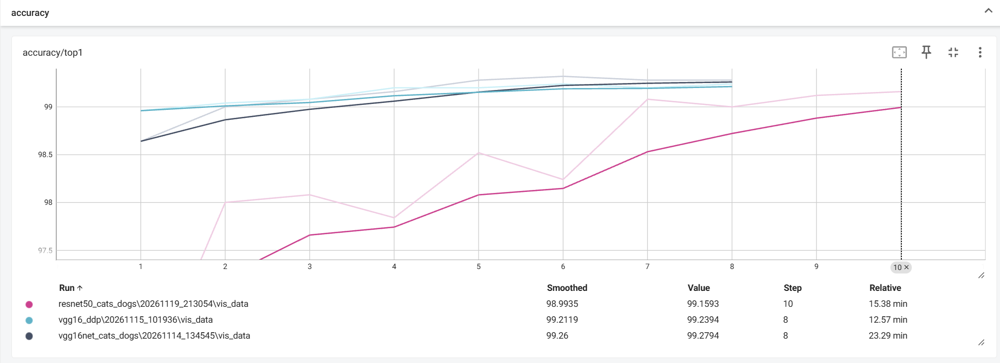
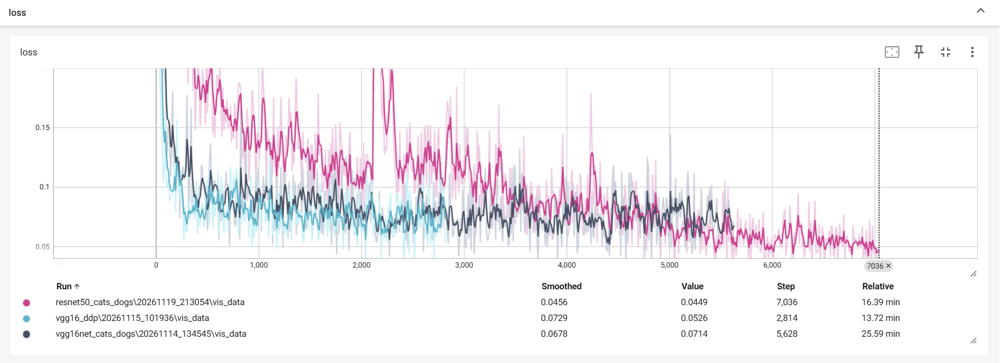

# ResNet-50 + SE-ResNet-50：从零复现 + 预训练迁移（PyTorch × MMPretrain）

手写 **ResNet-50** 与 **SE-ResNet-50**，接进 MMPretrain，证明与官方实现**结构完全等价**；再加载官方
ImageNet-1k 权重做猫狗迁移学习，配合 TensorBoard、实拍推理、SE 消融和 2×4090 DDP。
本次只复现 **ResNet-50 / SE-ResNet-50**，不涉及 18/34/101/152。

| # | 目标 | 结果 |
| :-: | :--- | :--- |
| 1 | 手写 ResNet-50，与官方结构等价 | ✅ `318` 键、backbone **23.51M**、`max\|diff\| = 0.0` |
| 2 | 集成 SENet，SE-ResNet-50 与官方对齐 | ✅ `382` 键、backbone **26.04M**、`diff = 0.0`、只多 **+2.53M** |
| 3 | 加载官方 ImageNet-1k 权重 | ✅ ResNet-50 / SE-ResNet-50 均 `max\|diff\| = 0.0`；2 类只替换 `head.fc` |
| 4 | 猫狗迁移学习（目标 >95%） | ✅ ResNet-50 **99.16%**；SE-ResNet-50 **99.32%** |
| 5 | TensorBoard + 实拍推理 | ✅ loss/acc/lr 曲线；ResNet-50 5/5，SE-ResNet-50 4/5 |
| 6 | 2×4090 DDP | ✅ ResNet-50 **99.16%**（6:50）；SE-ResNet-50 **99.00%**（7:55） |

## 环境

| 组件 | 版本 / 配置 |
| :--- | :--- |
| Python | 3.12.10 |
| PyTorch | 2.11.0+cu128 |
| mmpretrain | 1.2.0 |
| mmengine | 0.10.7 |
| mmcv | 2.2.0（**lite**，纯 Python，不编译 CUDA 算子） |
| tensorboard | 2.21.0 |
| 本机 | RTX 5060 Laptop 8GB / Ultra 9 275HX / 32GB RAM（Windows） |
| 云端 | 恒源云 **2×RTX 4090 24GB**（Linux，NCCL） |
| 数据 | 微软猫狗 24,997 张可用，9:1 切成 **22,499 训练 / 2,498 验证** |

```powershell
cd D:\具身智能\Pratice_project
# .venv 已就绪，不需要重新安装
.\.venv\Scripts\python.exe -c "import torch, mmpretrain, mmengine, mmcv; print(torch.__version__, mmpretrain.__version__, mmengine.__version__, mmcv.__version__)"
```

## 快速开始

**所有命令都在 `Pratice_project/` 下执行**，配置里的 `data_root = "data/cats_dogs"` 是相对当前工作目录的。

```powershell
cd D:\具身智能\Pratice_project

# 1) 环境冒烟
.\.venv\Scripts\python.exe ResNet\tools\check_env.py

# 2) 结构对齐：ResNet-50 / SE-ResNet-50
.\.venv\Scripts\python.exe ResNet\tools\check_parity.py
.\.venv\Scripts\python.exe ResNet\tools\check_se_parity.py

# 3) 官方权重加载（首次会下载 ~98MB / ~100MB）
.\.venv\Scripts\python.exe ResNet\tools\check_pretrain.py

# 4) 单卡训练
.\.venv\Scripts\python.exe ResNet\tools\train.py ResNet\config\resnet50_cats_dogs.py
.\.venv\Scripts\python.exe ResNet\tools\train.py ResNet\config\seresnet50_cats_dogs.py

# 5) TensorBoard
.\.venv\Scripts\tensorboard.exe --logdir work_dirs --port 6006

# 6) 批量推理（自动选 epoch 最大的 best checkpoint）
.\.venv\Scripts\python.exe ResNet\tools\infer_execute.py
.\.venv\Scripts\python.exe ResNet\tools\infer_execute.py ^
  --config ResNet\config\seresnet50_cats_dogs.py ^
  --work-dir work_dirs\seresnet50_cats_dogs
```

2×4090 DDP：

```bash
# 云端，代码/数据在 /hy-tmp/Pratice_project
torchrun --nproc_per_node=2 --master_port=29501 ResNet/tools/train.py \
    ResNet/config/resnet50_cats_dogs.py --launcher pytorch \
    --work-dir /hy-tmp/work_dirs/resnet50_ddp

torchrun --nproc_per_node=2 --master_port=29502 ResNet/tools/train.py \
    ResNet/config/seresnet50_cats_dogs.py --launcher pytorch \
    --work-dir /hy-tmp/work_dirs/seresnet50_ddp
```

## 项目结构

```
ResNet/
├── config/
│   ├── resnet50_cats_dogs.py       # ★ ResNet-50 猫狗训练
│   └── seresnet50_cats_dogs.py     # ★ SE-ResNet-50 猫狗训练
├── resnet/
│   ├── __init__.py                 # import 后注册 MyResNet / MySEResNet
│   └── backbones/
│       ├── resnet.py               # ★ 手写 ResNet-50（注册名 MyResNet）
│       └── senet.py                # ★ SELayer / SEBottleneck / SEResNet
├── tools/
│   ├── check_env.py                # 环境冒烟
│   ├── check_parity.py             # ResNet-50 结构对齐
│   ├── check_se_parity.py          # SE-ResNet-50 结构对齐
│   ├── check_pretrain.py           # 官方权重 + 2 类替换
│   ├── train.py                    # 训练入口（DDP 用 --launcher pytorch）
│   ├── infer.py                    # 单张/少量图片推理
│   ├── infer_execute.py            # 目录批量推理，自动选 best ckpt
│   ├── visualize_se.py             # SE 门控统计
│   └── compat.py                   # torch>=2.6 的 torch.load 补丁
├── shotcut/                        # TensorBoard 截图
└── docs/                           # 01 代码 / 02 训练 / TODOLIST
```

## 实现要点

### 1. ResNet-50 只做标准 Bottleneck

- `stem`：`7×7/2 conv 64` + BN + ReLU + `3×3/2 maxpool`，224 输入到 layer1 是 56×56。
- 4 个 stage：`[3, 4, 6, 3]` 个 Bottleneck，输出通道 `256/512/1024/2048`。
- Bottleneck：`1×1 → 3×3(stride) → 1×1`，expansion=4；shortcut 在 stride≠1 或通道变化时用
  `1×1 conv + BN` 投影。
- 所有卷积 `bias=False`；BN 的 `eps=1e-5`。
- **分类器在 head，不在 backbone**：`backbone` 输出 `(B,2048,7,7)`，`GlobalAveragePooling` 压成
  `(B,2048)`，`LinearClsHead.fc` 做 `2048→2`。官方权重键是 `head.fc.weight`，不是 VGG 的 `classifier.6`。

注册名用 `MyResNet` / `MySEResNet`，避免和 mmpretrain 官方 `ResNet` / `SEResNet` 冲突。

### 2. SENet 集成

SE 插在 Bottleneck 的最后一个 BN 之后、残差相加之前：

```text
conv3 → BN → SE(squeeze-excitation) → + shortcut → ReLU
```

- `SELayer`：`AdaptiveAvgPool2d(1) → 1×1 conv(C→C/16) → ReLU → 1×1 conv(C/16→C) → Sigmoid`，再逐通道乘回。
- 属性名必须是 `se_layer`，官方键是 `layer1.0.se_layer.conv1.conv.weight`。
- ResNet-50 有 16 个 Bottleneck → **64 个 SE 参数键**；普通 ResNet-50 权重灌进 SE-ResNet-50 时，
  恰好缺这 64 个键。
- SE-ResNet-50 backbone 26.04M，比 ResNet-50 多 **2.53M（+10.8%）**。

### 3. 官方权重加载

| 方式 | 用途 |
| :--- | :--- |
| `get_model("resnet50_8xb32_in1k", pretrained=True)` | 官方基线 / 结构验证 |
| `cfg.load_from = "<URL 或本地路径>"` | **迁移学习用这个**，`Runner.train()` 生效 |
| `backbone.init_cfg = Pretrained` | 只初始化 backbone，`get_model()` 不生效 |

2 类时只重建 `head.fc`，日志里出现两条：

```text
size mismatch for head.fc.weight: 1000×2048 vs 2×2048
size mismatch for head.fc.bias:   1000     vs 2
```

是**预期行为**，其余 318 / 382 个键全部复用。

### 4. DDP

- 本机 Windows 无 NCCL，只能单卡；多卡上恒源云 2×4090。
- `torchrun --nproc_per_node=2 ... --launcher pytorch`，`env_cfg.dist_cfg.backend="nccl"`。
- `auto_scale_lr(base_batch_size=32)`：每卡 bs32、总 batch 64，lr 从 `1e-2` 自动变 **`2e-2`**。
- 每卡约 1.7GB（ResNet-50）/ 2.1GB（SE），24GB 卡很宽裕。

## 验收结果

### 结构对齐

```text
ResNet-50     keys=318  backbone=23.51M  full=25.56M  diff=0.0
SE-ResNet-50  keys=382  backbone=26.04M  full=28.09M  diff=0.0
```

- ResNet-50：与官方 `ResNet` 的 `state_dict` 键集合/形状完全一致，前向逐位 `diff=0.0`。
- SE-ResNet-50：与官方 `SEResNet` 完全一致；只比 ResNet-50 多 2.53M 参数。

### 官方权重

```text
[ResNet-50 1000]    backbone keys 318  max |diff| = 0.0
[SE-ResNet-50 1000] backbone keys 382  max |diff| = 0.0
[2 类] 只报 head.fc.weight / head.fc.bias 两条 size mismatch
[ResNet-50 -> SE-ResNet-50] missing 64，全部是 se_layer
全部通过 ✅
```

### 猫狗单卡（RTX 5060 Laptop 8GB）

| epoch | ResNet-50 loss | ResNet-50 top-1 | SE-ResNet-50 loss | SE-ResNet-50 top-1 |
| :-: | :-: | :-: | :-: | :-: |
| 1 | 0.2536 | 95.92 | 0.2630 | 95.92 |
| 2 | 0.1430 | 98.00 | 0.1898 | 96.96 |
| 3 | 0.1165 | 98.08 | 0.1388 | 97.76 |
| 4 | 0.1466 | 97.84 | 0.1075 | 98.12 |
| 5 | 0.1094 | 98.52 | 0.0924 | 98.16 |
| 6 | 0.0856 | 98.24 | 0.0818 | 98.76 |
| 7 | 0.0805 | 99.08 | 0.0698 | 98.60 |
| 8 | 0.0618 | 99.00 | 0.0579 | 99.16 |
| 9 | 0.0571 | 99.12 | 0.0528 | **99.32** |
| **10** | 0.0531 | **99.16** | 0.0493 | 99.12 |

| 模型 | best top-1 | 最佳 epoch | 10 epoch 耗时 | 峰值显存 | best ckpt |
| :--- | :-: | :-: | :-: | :-: | :--- |
| ResNet-50 | **99.16%** | 10 | **17:08** | ~1.6 GB | `work_dirs/resnet50_cats_dogs/best_accuracy_top1_epoch_10.pth` |
| SE-ResNet-50 | **99.32%** | 9 | **20:52** | ~2.0 GB | `work_dirs/seresnet50_cats_dogs/best_accuracy_top1_epoch_9.pth` |

**SE 消融结论**：SE 比 ResNet-50 高 **+0.16 个点**（99.32 vs 99.16），代价是
**+2.53M 参数（+10.8%）**、训练时间 **+22%**。只有一次 run，猫狗又是简单二分类，
这个差距只能算“小幅提升/在噪声边缘”，不能过度解读。

### TensorBoard

同一页面里也叠加了 VGGNet 的 run 做对比，粉色是 ResNet-50：





### 2×4090 DDP

| epoch | ResNet-50 DDP top-1 | SE-ResNet-50 DDP top-1 |
| :-: | :-: | :-: |
| 1 | 96.56 | 94.84 |
| 2 | 97.80 | 96.60 |
| 3 | 97.56 | 97.60 |
| 4 | 98.00 | 98.36 |
| 5 | 98.24 | 98.44 |
| 6 | 98.40 | 98.52 |
| 7 | 98.64 | 98.72 |
| 8 | 99.16 | 98.80 |
| 9 | 99.00 | 98.84 |
| **10** | 99.04 | **99.00** |

| 模型 | 单卡 best | DDP best | 单卡 final | DDP final | 单卡耗时 | DDP 耗时 |
| :--- | :-: | :-: | :-: | :-: | :-: | :-: |
| ResNet-50 | 99.16（ep10） | **99.16（ep8）** | 99.16 | 99.04 | 17:08 | **6:50** |
| SE-ResNet-50 | 99.32（ep9） | **99.00（ep10）** | 99.12 | 99.00 | 20:52 | **7:55** |

- DDP 日志均为 `Distributed training: True`，`GPU number: 2`，lr `2.0000e-02`。
- 2 卡与单卡 best 差：ResNet-50 **0.00 点**；SE-ResNet-50 **0.32 点**，均 < 1 点。
- 端到端 17:08→6:50（2.50×）、20:52→7:55（2.64×），但单卡是 5060、双卡是 2×4090，
  **硬件不同**，这不是纯 DDP 加速比；同机单卡 4090 的对照没有跑。
- 结果目录：`work_dirs/resnet50_ddp/`、`work_dirs/seresnet50_ddp/`（FileZilla 从云端拉回）。

### 实拍推理

`validation_photos/` 5 张狗图，两个模型各跑一遍：

| 图片 | ResNet-50 | SE-ResNet-50 | 结果 |
| :--- | :--- | :--- | :--- |
| dog1.png | dog 1.0000 | dog 1.0000 | ✅ / ✅ |
| dog2.jpg | dog 0.9948 | dog 0.9992 | ✅ / ✅ |
| dog3.jpg | dog 1.0000 | dog 1.0000 | ✅ / ✅ |
| dog4.jpg | dog 0.8637 | **cat 0.5868**（dog 0.4132） | ✅ / ❌ |
| dog5.jpg | dog 1.0000 | dog 1.0000 | ✅ / ✅ |

- ResNet-50：**5/5**；SE-ResNet-50：**4/5**。
- 样本只有 5 张，不能据此判断模型强弱；以 2,498 张验证集为准。
- dog4 是 SE 在二分类边界上的失败样本，如实保留。

### SE 门控（dog1，SE-ResNet-50 epoch 9）

```text
预测: dog | 概率: 1.0000
layer1: mean=0.4533 std=0.0982 min=0.0306 max=0.6854
layer2: mean=0.4864 std=0.0803 min=0.0213 max=0.7133
layer3: mean=0.4875 std=0.0748 min=0.0242 max=0.7347
layer4: mean=0.8088 std=0.2203 min=0.1974 max=0.9999
```

layer4 的 gate 均值 0.81，说明深层 SE 门控明显打开；但这只能说明门控不是恒定的，
不能直接当成“SE 学到了语义”的证据。

## 已知限制

1. **只做 ResNet-50 / SE-ResNet-50**：18/34/101/152 不在本次范围；参考实现里保留了代码分支，但不达标。
2. **本机不能跑 GPU DDP**：Windows 无 NCCL，`gloo`+CUDA 崩溃、`torchrun` 报 libuv；
   DDP 全部在恒源云 2×4090 上完成。
3. **没有做 ImageNet 全量训练**：只验证结构对齐和权重加载，不对比论文的 76.55/77.74。
4. **DDP 加速比受硬件影响**：单卡 5060、双卡 4090，2.50×/2.64× 只是端到端参考，
   不是同机 2 卡相对 1 卡的纯 DDP scaling。
5. **实拍样本太少**：5 张里 SE 错 1 张；2 分类也没有“都不是”的拒识能力。

## 踩坑记录

| 现象 | 原因 | 解决 |
| :--- | :--- | :--- |
| `ImportError: cannot import name 'make_divisible' from 'mmcv.utils'` | `mmcv-lite` 没导出该符号 | 用 `from mmpretrain.models.utils import make_divisible` |
| SE 配置报 `KeyError: 'MySEResNet' is not in the registry` | 入口只 import 了 `resnet.backbones.resnet`，没有 import `senet.py` | 用 `import resnet` 做包级导入 |
| `AttributeError: 'ResNet' object has no attribute 'make_res_layer'` | `make_res_layer` / `@property` / `forward` 被缩进进 `__init__` | 方法必须和 `__init__` 同级（4 空格） |
| `size mismatch for head.fc.*` | 1000 类 → 2 类，正常 | **预期行为**，前 318/382 个键照常复用 |
| `missing keys ... se_layer...`（恰好 64 条） | 普通 ResNet-50 权重灌进 SE 模型 | **预期行为**；想全复用就加载官方 SE 权重 |
| `FileNotFoundError: work_dirs/.../epoch_1.pth` | check 脚本里残留了预训练后的 ckpt 读取代码 | 删除该行；parity 不需要自己的 ckpt |
| 云端 `No module named 'resnet'` | 只解压了代码，没装包 | `cd ResNet && pip install -e . --no-build-isolation`；`train.py` 也会把 `ResNet/` 加进 `sys.path` |
| 云端 `Failed to initialize NumPy: _ARRAY_API not found` | 镜像 torch 按 numpy 1.x 编译，环境是 numpy 2.x | `pip install "numpy<2"` |
| 云端 `mmcv` 混装报错 | 同时装了 `mmcv` 和 `mmcv-lite` | 只保留一个；分类任务用 `mmcv-lite==2.2.0` |
| FileZilla 上传/下载 zip 损坏 | ASCII 传输 | 传输类型改 **Binary** |

## 数据集与参考

- 数据：[Microsoft Cats and Dogs](https://download.microsoft.com/download/3/E/1/3E1C3F21-ECDB-4869-8368-6DEBA77B919F/kagglecatsanddogs_5340.zip)
  （Kaggle `dogs-vs-cats` 已关闭）
- ResNet 论文：[Deep Residual Learning for Image Recognition](https://arxiv.org/abs/1512.03385)
- SENet 论文：[Squeeze-and-Excitation Networks](https://arxiv.org/abs/1709.01507)
- 官方权重：
  - [resnet50_8xb32_in1k](https://download.openmmlab.com/mmclassification/v0/resnet/resnet50_8xb32_in1k_20210831-ea4938fc.pth)
  - [se-resnet50_batch256_imagenet](https://download.openmmlab.com/mmclassification/v0/se-resnet/se-resnet50_batch256_imagenet_20200804-ae206104.pth)
- 文档：[01_代码部分.md](docs/01_代码部分.md)、[02_训练部分.md](docs/02_训练部分.md)、[TODOLIST.md](docs/TODOLIST.md)
- 结果：`work_dirs/resnet50_cats_dogs/`、`work_dirs/seresnet50_cats_dogs/`、
  `work_dirs/resnet50_ddp/`、`work_dirs/seresnet50_ddp/`
