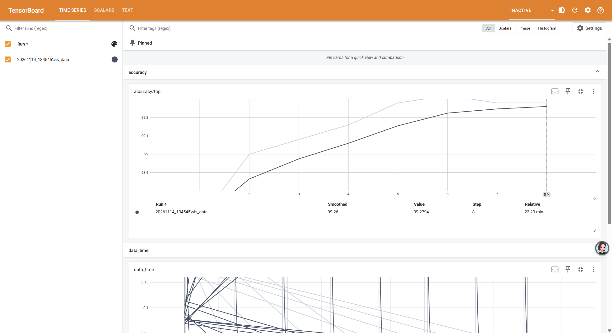
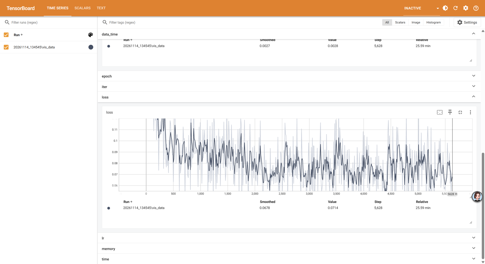

# VGGNet：从零复现 + 预训练迁移（PyTorch × MMPretrain）

用 PyTorch 手写 VGG16，接进 MMPretrain，证明与官方实现**结构完全等价**，再加载官方 ImageNet 权重做猫狗迁移学习，
配合 TensorBoard 与实拍图推理。**不训练 ImageNet 全量**（本机 8GB 笔记本跑 100 epoch 要 12 天以上，没有意义）。

| # | 目标 | 结果 |
| :-: | :--- | :--- |
| 1 | 手写 VGG16，与官方结构等价 | ✅ 8 个变体 `state_dict` 逐键一致、`max\|diff\| = 0.0`、VGG16 **138.36M** |
| 2 | 加载官方 ImageNet-1k 权重 | ✅ 1000 类逐层灌入 `diff = 0.0`；2 类时只重建 `classifier.6` |
| 3 | 猫狗迁移学习（目标 > 95%） | ✅ 验证集 **99.32%**（epoch 6 最佳），8 epoch 约 **25 分钟** |
| 4 | TensorBoard + 实拍图推理 | ✅ loss / accuracy / lr 曲线；实拍 6 张，其中 5 张狗全部正确 |
| — | DDP 多卡（恒源云 2 卡） | ✅ 2×RTX 3090，8 epoch **99.24%**，**14.4 分钟**（单卡 25.6 分钟，约 1.78×） |

## 环境

| 组件 | 版本 |
| :--- | :--- |
| Python | 3.12.10 |
| PyTorch | 2.11.0+cu128 |
| mmpretrain | 1.2.0 |
| mmengine | 0.10.7 |
| mmcv | 2.2.0（**lite**，纯 Python，不编译 CUDA 算子） |
| tensorboard | 2.21.0 |
| 硬件 | 本机：RTX 5060 Laptop 8GB / Ultra 9 275HX / 32GB RAM（Windows）<br>云端：2×RTX 3090 24GB（Linux，恒源云） |

```powershell
python -m venv .venv
.\.venv\Scripts\Activate.ps1
pip install torch torchvision --index-url https://download.pytorch.org/whl/cu128
pip install mmpretrain==1.2.0 mmengine==0.10.7 mmcv-lite==2.2.0 tensorboard
cd VGGNet
pip install -e . --no-build-isolation
```

> 中文 Windows 建议设 `PYTHONUTF8=1`（用户环境变量），否则 mmengine 收集环境信息时可能 GBK 解码崩溃。
> 启动时那条 `Fail to import MultiScaleDeformableAttention` 是 mmcv-lite 的警告，**无害**。

## 快速开始

**所有命令都在 `Pratice_project/` 下执行**——配置里的 `data_root = "data/cats_dogs"` 是相对当前工作目录的。

```powershell
cd D:\具身智能\Pratice_project

# 1) 下数据（微软镜像，约 787MB；支持断点续传）
python VGGNet\tools\download_dataset.py
#    → data/raw/PetImages/{Cat,Dog}，各 12,500 张

# 2) 整理成 ImageNet 目录结构（9:1 切分，自动跳过 0 字节坏图）
python VGGNet\tools\prepare_cats_dogs.py --src data\raw\PetImages
#    → data/cats_dogs/{train,val}/{cat,dog}

# 3) 训练前扫一遍坏图（训练时遇到解码失败的图会直接中断）
python VGGNet\tools\check_corrupt_images.py --src data\cats_dogs --delete

# 4) 微调（8 epoch，加载官方权重，AMP + bs32）
python VGGNet\tools\train.py VGGNet\config\vgg16net_cats_dogs.py

# 5) TensorBoard
.\.venv\Scripts\tensorboard.exe --logdir work_dirs --port 6006

# 6) 批量推理（自动选 epoch 最大的 best checkpoint）
python VGGNet\tools\infer_execute.py

# 7) 把结果汇总成 summary.md / summary.json
python VGGNet\tools\summarize_results.py
```

环境自检 / 结构验收：

```powershell
python VGGNet\tools\check_env.py             # logits (2,1000)、params 138.36
python VGGNet\tools\check_parity.py          # 单变体 diff = 0.0
python VGGNet\tools\check_all_variants.py    # 8 变体 diff = 0.0
python VGGNet\tools\check_pretrain.py        # 官方权重 diff = 0.0；2 类替换
```

## 项目结构

```
VGGNet/
├── config/
│   ├── vgg16net_cats_dogs.py    # ★ 猫狗迁移学习（自包含配置）
│   ├── vgg16net_mini.py         # 假数据冒烟
│   └── vgg16net_8xb32_in1k.py   # ImageNet 100 epoch（留档，本机不跑）
├── vggnet/backbones/vgg.py      # ★ 手写 VGG（注册名 "VGGNet"）
├── tools/
│   ├── download_dataset.py      # 微软镜像下载（断点续传 / 大小校验 / 解压）
│   ├── prepare_cats_dogs.py     # 两种布局 → train/val + cat/dog
│   ├── check_corrupt_images.py  # 扫描 / 删除无法解码的图片
│   ├── check_env.py             # 环境冒烟
│   ├── check_parity.py          # 单变体结构对齐
│   ├── check_all_variants.py    # 8 变体结构对齐
│   ├── check_pretrain.py        # 官方权重加载（1000 类 + 2 类）
│   ├── train.py                 # 训练入口（DictAction / --launcher / compat）
│   ├── infer.py                 # 单张推理
│   ├── infer_execute.py         # 目录批量推理（自动选 best ckpt）
│   ├── summarize_results.py     # 汇总 log + scalars → summary.md/json
│   ├── compat.py                # torch>=2.6 的 torch.load 补丁
│   └── make_fake_imagenet.py    # 造 16 张假图
├── shotcut/                     # TensorBoard 截图
└── docs/                        # 分阶段 TODO：01 代码部分 / 02 训练部分
```

## 实现要点

**1. 3 层 FC 放在 backbone 内部**（和官方一致）

官方发布权重的键是 `backbone.classifier.0/3/6.weight`，FC 必须在 backbone 里才对得上。
`num_classes > 0` 时 backbone 直接输出 `(B, num_classes)`，`out_indices` 默认 `(5,)`（哨兵值，不输出特征图）；
`num_classes <= 0` 时默认 `(4,)`，输出 `(B, 512, 7, 7)` 特征图。

**2. 注册名必须避开官方的 `VGG`**

```python
@MODELS.register_module("VGGNet")   # 不传名字会用类名 "VGG"，直接 KeyError
class VGG(BaseBackbone):
    ...
```

**3. 三处 `num_classes` 必须一致**：`backbone.num_classes`、`data_preprocessor.num_classes`、`classes=("cat","dog")`。

**4. 迁移学习只重建最后一层**：`load_from` 官方 1000 类权重时，`classifier.6` 尺寸不匹配会被 mmengine 跳过，
日志里出现两条 `size mismatch ... classifier.6` 是**预期行为**，其余 30 个键全部复用。

## 验收结果

### 结构对齐（8 变体）

```
depth=11 type=plain params= 132.86M diff=0.0
depth=13 type=plain params= 133.05M diff=0.0
depth=16 type=plain params= 138.36M diff=0.0
depth=19 type=plain params= 143.67M diff=0.0
depth=11 type=bn  params= 132.87M diff=0.0
depth=13 type=bn  params= 133.05M diff=0.0
depth=16 type=bn  params= 138.37M diff=0.0
depth=19 type=bn  params= 143.68M diff=0.0
```

### 官方权重加载

```
[1000 类] missing: [] unexpected: [] keys: 32 max |diff| = 0.0
[2 类]    conv 权重一致: True  FC1 权重一致: True  classifier.6: (2, 4096)  输出: (1, 2)
```

### 猫狗迁移学习（24,997 张，22,499 训练 / 2,498 验证）

| epoch | iters | loss(avg) | s/iter | lr | val top-1 |
| :-: | :-: | :-: | :-: | :-: | :-: |
| 1 | 704 | 0.1339 | 0.231 | 1.0e-4 | 98.64 |
| 2 | 704 | 0.0890 | 0.230 | 9.6e-5 | 99.00 |
| 3 | 704 | 0.0839 | 0.229 | 8.6e-5 | 99.08 |
| 4 | 704 | 0.0752 | 0.232 | 6.9e-5 | 99.16 |
| 5 | 704 | 0.0748 | 0.223 | 5.1e-5 | 99.28 |
| **6** | 704 | 0.0748 | 0.228 | 3.2e-5 | **99.32** |
| 7 | 704 | 0.0753 | 0.229 | 1.5e-5 | 99.28 |
| 8 | 704 | 0.0748 | 0.228 | 5.0e-6 | 99.28 |

- batch 32 + AMP，`~0.23 s/iter`，8 epoch 共 **约 25 分钟**（含每轮验证）
- 最佳权重：`work_dirs/vgg16net_cats_dogs/best_accuracy_top1_epoch_6.pth`

#### 双卡 DDP（恒源云 2×RTX 3090）

| 项 | 单卡 | 双卡 DDP |
| :--- | :--- | :--- |
| 硬件 | RTX 5060 Laptop 8GB | 2×RTX 3090 24GB |
| 每卡 batch / 总 batch | 32 / 32 | 32 / 64 |
| lr（`auto_scale_lr`） | 1.0e-4 | **2.0e-4** |
| iters / epoch | 704 | 352 / 卡 |
| 单 epoch | ~3.2 min | ~1.8 min |
| 8 epoch 总计（含验证） | ~25.6 min | **14.4 min** |
| best val top-1 | 99.32%（ep6） | 99.24%（ep6） |
| 最终 val top-1 | 99.28% | 99.24% |

- 启动方式：`torchrun --nproc_per_node=2 VGGNet/tools/train.py VGGNet/config/vgg16net_cats_dogs.py --launcher pytorch --work-dir work_dirs/vgg16_ddp`，日志里 `Distributed training: True`
- 每卡显存约 **2.7 GB**（bs32 + AMP），2×3090 上 8 epoch 共 **14 分 23 秒**，相对单卡约 **1.78×**
- 精度与单卡差 **0.08 个点**（< 1 点），符合 DDP 预期
- 结果保存在 `work_dirs/vgg16_ddp/20261115_101936/`（日志 / events / scalars / best ckpt）

TensorBoard 曲线：





> 同一份数据在恒源云 2 卡上跑 DDP 复现时，`auto_scale_lr` 会按 总 batch/32 自动把 lr ×2。

## 推理示例

```powershell
python VGGNet\tools\infer_execute.py
# 或指定目录 / 权重
python VGGNet\tools\infer_execute.py --img-dir D:\photos --checkpoint work_dirs\vgg16net_cats_dogs\best_accuracy_top1_epoch_6.pth
```

`validation_photos/` 的实测输出：

| 图片 | 预测 | 概率 |
| :--- | :--- | :--- |
| dog1.png | dog | 0.9988 |
| dog2.jpg | dog | 0.9996 |
| dog3.jpg | dog | 0.9999 |
| dog4.jpg | dog | 0.9904 |
| dog5.jpg | dog | 0.9994 |
| person1.jpg | dog | 0.6673 |

> 最后一张是「非猫非狗」的测试：2 分类模型只能在猫/狗里二选一，概率接近 0.5 属于正常现象。
> 想输出"都不是"，需要加第三个类或加拒识阈值。

## 已知限制

1. **本机不能跑 GPU DDP**：Windows 无 NCCL，`gloo` + CUDA 会崩溃（`3221225477`），`torchrun` 还会报 libuv；
   已在恒源云 2×3090（Linux）上完成验证（见上方 DDP 结果），命令见 `docs/02_训练部分.md` 的 Phase 10。
2. **只支持 224×224 输入**：classifier 输入维度硬编码 `512*7*7`，换分辨率会报 `mat1 and mat2 shapes cannot be multiplied`。
3. **没有做 ImageNet 全量训练**，不对比论文的 71.6/73.7。
4. 数据集来自微软镜像（Kaggle 比赛已关闭），逐张 `cv2` 解码校验后可用 24,997 张。

## 踩坑记录

| 现象 | 原因 | 解决 |
| :--- | :--- | :--- |
| `UnboundLocalError: cannot access local variable 'config'` | `get_model(dict(...))` 传了普通 dict | 传 `Config(dict(model=...))` |
| `cannot pickle 'module' object` | config 里写了 `import tensorboard`，模块对象进了 Config | 用 `__import__("tensorboard")` |
| `RuntimeError`（LazyObject） | config 里 `from x import f` 后调用 f | config 里不要 import 再调用 |
| `UnpicklingError: Weights only load failed` | torch≥2.6 默认 `weights_only=True` 读 mmengine ckpt | `tools/compat.py` 补丁 |
| `FileNotFoundError: 'data/cats_dogs\train'` | 在 `VGGNet/` 下启动，`data_root` 相对路径解析错 | 在 `Pratice_project/` 下启动 |
| `FileNotFoundError: ...best_accuracy_top1_epoch_8.pth` | best 的 epoch 号不固定（本项目是 6） | 用 `infer_execute.py` 自动选，或先 `dir` 看实际文件名 |
| DataLoader 报图片解码失败 | 数据集有坏图（`Cat/10404.jpg` 等） | 训练前跑 `check_corrupt_images.py --delete` |
| 云端 `ModuleNotFoundError: No module named 'vggnet'` | 只解压了源码，没做 editable 安装 | `cd VGGNet && pip install -e . --no-build-isolation` |
| 云端 `Failed to initialize NumPy: _ARRAY_API not found` | 镜像 torch 按 numpy 1.x 编译，环境却是 numpy 2.x | `python -m pip install "numpy<2"` |
| 云端 `/hy-tmp` 关机后文件消失 | 实例本地盘，关机 24h 自动清空 | 结果 `zip` + `oss cp` 回个人数据 |
| 内存/显存不够 | VGG16 138M 参数 + 224 输入 | bs32 + AMP（峰值约 3GB），或降 batch |

## 数据集与参考

- 数据：[Microsoft Cats and Dogs](https://download.microsoft.com/download/3/E/1/3E1C3F21-ECDB-4869-8368-6DEBA77B919F/kagglecatsanddogs_5340.zip)（Kaggle `dogs-vs-cats` 已关闭）
- 权重：[vgg16_batch256_imagenet](https://download.openmmlab.com/mmclassification/v0/vgg/vgg16_batch256_imagenet_20210208-db26f1a5.pth)
- 论文：[Very Deep Convolutional Networks for Large-Scale Image Recognition](https://arxiv.org/abs/1409.1556)
- 文档：`docs/01_代码部分.md`（环境→结构→手写→对齐→加载权重）、`docs/02_训练部分.md`（数据→训练→TB→推理→DDP）
